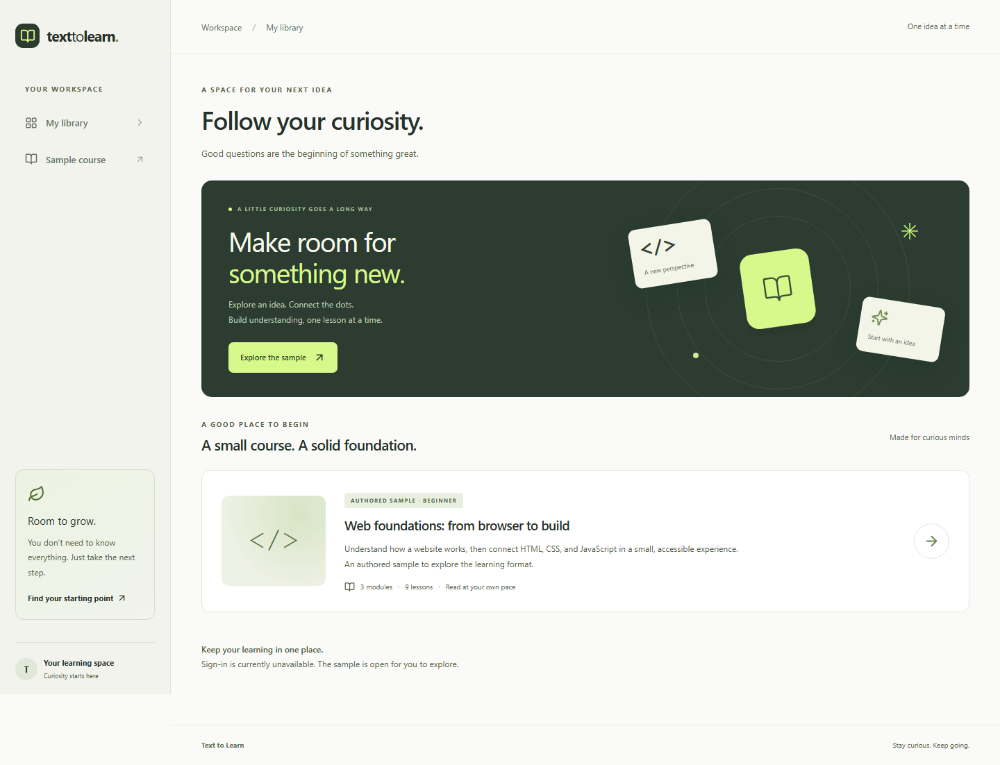
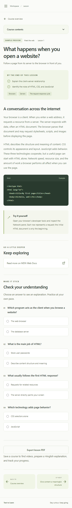
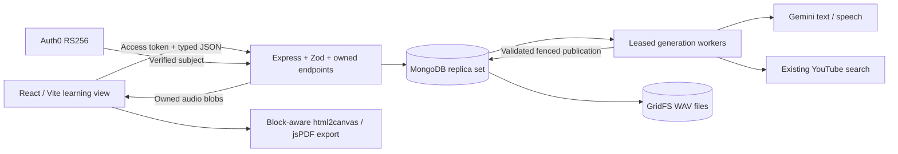

# Text to Learn

A learning workspace for people who have a topic but need an ordered path through it. Text to Learn turns topic input into a validated saved course, generates lessons on demand, and keeps quizzes, readings, media and progress together. **Weeks 1–3 are complete locally; Week 4 verifies the full journey and prepares submission.** Live provider quality, actual tenant login and public deployments need external setup. The final submission is incomplete while those checks and the recorded demo are missing.

## What works

- Public sample: 3 modules, 9 authored lessons, objectives/topics, curated MDN reading links, safe code/text rendering and 4 practice MCQs per lesson.
- Protected personal library: save a titled sample copy, list/open courses, navigate stable lesson URLs, refresh saved content and delete a course with its children atomically.
- Topic submission: saved outline with 3–6 modules and 3–5 lessons/module, objectives/topics/resources for every lesson, and explicit generation status. First opening generates a rich lesson; reopening reuses stored content.
- Durable MongoDB jobs with atomic leases, fenced publication, deadline/retry bounds and restart recovery. Duplicate submissions and concurrent lesson requests share existing work; invalid output never becomes ready.
- Safe code highlighting, interactive explained quizzes, catalogue readings and labelled unresolved suggestions, video search ideas, previous/next navigation and controlled retry.
- User-triggered YouTube search with embeddable/public filtering and daily caching; title/channel, opt-in embeds, external links and empty/unavailable states. These are existing videos.
- User-triggered Hinglish transcript and configurable speech model/voice, independently cached and retried. Validated WAV playback/download uses authenticated blob reads and never autoplays.
- Durable audio through a GridFS storage adapter, 12 MB/four-minute limits, ownership and restart-safe cleanup. Production audio never depends on Render's filesystem.
- Full single-lesson PDF with objectives, blocks/code, resource/video links and MCQ answers. A dedicated page layout splits oversized text/code before page-sized captures. Idempotent completion and course/library progress survive reopening.
- Auth0 redirect login/logout and RS256 access-token verification; the server derives ownership from verified `sub`. Other users cannot list/read/delete a saved copy.
- MongoDB User/Course/Module/Lesson/Progress/GenerationJob/Enhancement/AudioAsset records, indexes, transactions and model/version-aware hashes.
- Strict shared Zod contracts, startup configuration checks, health/readiness, CORS/request bounds/rate limits, safe error envelopes, npm workspaces, CI and deployment configuration.

The project initially contained only the specification and inherited an unrelated parent Git repository. It now has a standalone repository and focused local commits on `codex/week-4-verification`. No remote, push, account change or deployment has been created. The original supplied prompt is preserved locally and excluded from agent commits.

## Screenshots

Production-build screenshots show the real SDK with sign-in unavailable until configured. Saved/generated/media screenshots in earlier evidence use explicitly authored browser fixtures.




[Week 2 evidence](docs/weeks/week-2/verification.md) and [Week 3 evidence](docs/weeks/week-3/verification.md) contain saved generation, Hinglish/media and multi-page PDF examples. [Week 4 screenshots](docs/weeks/week-4/screenshots) include actual doubled-text reflow checks.

## Architecture, data and generation



| Data                | Purpose                                                                               |
| ------------------- | ------------------------------------------------------------------------------------- |
| User, Course        | Verified subject, owned library/counters, topic/request identity and generation state |
| Module, Lesson      | Ordered stable UUIDs, metadata, discriminated rich content, model/version/hash        |
| Progress            | Unique user/course completion set; idempotent mark and undo                           |
| GenerationJob       | Unique target, queued/running/ready/failed, attempts, deadlines and lease token       |
| Enhancement         | Source/model/language/voice cache variants for videos, transcript and audio           |
| AudioAsset + GridFS | Owned file references, WAV metadata, upload/publication/cleanup state                 |

Topic input is saved transactionally with an idempotency UUID and queued job. A worker asks the configured Gemini model for structured output, resolves approved resource IDs, validates fields/counts, then publishes the complete outline in a fenced transaction. Opening a lesson starts its unique job; validated rich blocks and four or five MCQs are persisted before ready. Reopening reads the cache. Independent video/transcript/audio jobs follow the same ownership/retry/publication controls. Expired leases recover after restart; recovery may repeat an upstream request. The [architecture](docs/ARCHITECTURE.md) explains indexes, fencing and cache identity.

## API overview

Private paths require a verified Bearer token; ownership comes from its subject. Another owner's records return 404. Shared contracts define bodies/responses; personal HTTP responses are no-store.

| Route                                               | Behavior                                                  |
| --------------------------------------------------- | --------------------------------------------------------- |
| GET /health, /ready, /api/sample                    | Public liveness, database readiness and authored sample   |
| GET/POST /api/courses                               | List owned library; save sample or submit topic/requestId |
| GET/DELETE /api/courses/:courseId                   | Owned detail or atomic parent/child deletion              |
| POST /api/courses/:courseId/retry                   | Controlled outline retry within attempt bounds            |
| GET /api/courses/:courseId/lessons/:lessonId        | Owned lesson/status/cache                                 |
| POST …/lessons/:lessonId/generate                   | Coalesced generation/manual retry                         |
| GET / POST …/lessons/:lessonId/enhancements[/:kind] | Cached status or explicit videos/transcript/audio request |
| GET …/lessons/:lessonId/audio/:assetId              | Owned WAV/download and single byte-range support          |
| POST …/lessons/:lessonId/completion                 | Idempotent completed boolean, returns saved progress      |

Exact inputs, envelopes, statuses and errors are in [API_CONTRACT.md](docs/API_CONTRACT.md).

## Local setup

Use **Node 24** (see `.node-version`) and npm. From this project root:

```sh
npm ci
```

For a credential-free, read-only sample preview:

```sh
npm run build -w @text-to-learn/contracts
npm run dev -w @text-to-learn/client
```

Open `http://127.0.0.1:5173`. Sign-in is visibly unavailable when Auth0 isn't configured; the app does not replace authentication with a development bypass.

For the full saved-course flow, copy `client/.env.example` to `client/.env` and `server/.env.example` to `server/.env`. On PowerShell:

```powershell
Copy-Item client/.env.example client/.env
Copy-Item server/.env.example server/.env
```

Edit those local files privately with your configuration. Never paste secrets into chat or commit the files. Use an Atlas database (replica sets support transactions), or start the supplied local replica set after starting Docker Desktop:

```sh
docker compose up -d --wait
npm run dev
```

MongoDB is bound to `127.0.0.1:27017` and uses a named data volume. `docker compose stop` stops it while preserving data. A standalone mongod is insufficient: the server checks replica-set/sharded transaction capability at startup. The current execution environment had no running Docker daemon; the compose startup was not executed here.

The API runs on port 3001 and Vite on 5173. The dev proxy forwards `/api`; health is `http://127.0.0.1:3001/health` and database readiness is `/ready`. Failed required configuration prevents API startup and names only invalid variables.

## Auth0 setup

1. Create an Auth0 **Single Page Application**. Use its domain and client ID in `VITE_AUTH0_DOMAIN`/`VITE_AUTH0_CLIENT_ID`. Do not use a client secret in the frontend.
2. Create an Auth0 API with identifier `https://text-to-learn-api` (or your chosen audience) and signing algorithm **RS256**. Put the identical identifier in `AUTH0_AUDIENCE` and `VITE_AUTH0_AUDIENCE`; use the same bare tenant/custom domain in `AUTH0_DOMAIN` and `VITE_AUTH0_DOMAIN`.
3. For local development, set **Allowed Callback URLs**, **Allowed Logout URLs**, and **Allowed Web Origins** to both `http://localhost:5173` and `http://127.0.0.1:5173`. The callback is the site origin; the SDK safely restores an internal return path.
4. Add the exact public Vercel HTTPS origin to all three Auth0 lists when hosting is configured. Add every explicitly allowed preview origin individually if you use previews; do not rely on wildcard tenant settings.
5. Test with two actual accounts: save a sample as User A, refresh/open a lesson, and confirm User B receives 404 for A's course/lesson/delete URLs. The automated suite verifies the same server checks with temporary signed fixture tokens; actual Auth0 login is a separate external verification.

The implementation follows the [Auth0 React access-token guide](https://auth0.com/docs/quickstart/spa/react) and [Express API JWT guide](https://developer.auth0.com/resources/guides/api/express/basic-authorization).

## Environment variables

| Location                        | Variable                                                     | Purpose                                                                                     |
| ------------------------------- | ------------------------------------------------------------ | ------------------------------------------------------------------------------------------- |
| Server                          | NODE_ENV, PORT                                               | Runtime mode and listener port; Render supplies PORT                                        |
| Server                          | CLIENT_ORIGINS                                               | Comma-separated exact HTTP(S) origins, no paths/trailing slashes; HTTPS in production       |
| Server                          | MONGODB_URI                                                  | Private MongoDB connection string; replica set/Atlas required                               |
| Server                          | AUTH0_DOMAIN, AUTH0_AUDIENCE                                 | Bare issuer domain and expected API identifier                                              |
| Client                          | VITE_AUTH0_DOMAIN, VITE_AUTH0_CLIENT_ID, VITE_AUTH0_AUDIENCE | Public Auth0 SPA configuration                                                              |
| Client                          | VITE_API_URL                                                 | Blank locally for the proxy; exact HTTPS Render origin when hosted                          |
| Server, required for generation | GEMINI_API_KEY, GEMINI_TEXT_MODEL                            | Course/lesson generation; choose a structured-output model supported in your Google project |
| Server, optional                | GEMINI_TTS_MODEL, GEMINI_TTS_VOICE                           | Hinglish speech generation; explicit supported Interactions model, Kore default voice       |
| Server, optional                | YOUTUBE_API_KEY                                              | Existing-video search; enable YouTube Data API v3 in your Google project                    |

Backend secret names must never start with VITE_. The examples contain only harmless placeholders.

Configure GEMINI_API_KEY and GEMINI_TEXT_MODEL privately in server/.env (or backend hosting environment). The adapter follows [Google's structured-output Interactions documentation](https://ai.google.dev/gemini-api/docs/structured-output); it sends a schema and validates the result again. The worker starts with the API and recovers expired jobs after restart. Limits: three active jobs/user, two initial automatic attempts, four attempts total after explicit retry, and a 45-second provider deadline. Requests return saved status promptly and the client polls. Recovery may replay upstream work; only database publication is fenced. Suspended hosting pauses processing until resume; no fixed completion time is promised.

The approved catalogue supplies clickable readings. Other suggestions have no generated URLs and are labelled unresolved. Video search uses lesson queries and fixed YouTube APIs, then rechecks embedding/privacy/age/region restrictions. Searches expire at the next UTC day, at most 24 hours. A cached empty result is an honest unavailable state. Structural validation does not guarantee factual accuracy; live quality still needs review.

Hinglish generation uses GEMINI_API_KEY/GEMINI_TEXT_MODEL. Speech additionally needs GEMINI_TTS_MODEL; choose a current model supporting audio output in the [official speech documentation](https://ai.google.dev/gemini-api/docs/speech-generation). Supported configured voices are Kore, Puck, Charon, Fenrir, Aoede, Zephyr, Orus and Leda. There is no silent model fallback. The adapter requests WAV, verifies the actual returned MIME/container/PCM layout, and wraps declared raw PCM only with explicit sample-rate metadata. Limits are 12,000,000 bytes and 240 seconds. Enhancement jobs share the three-active-job quota and four-attempt total bound; their worker has a 70-second overall deadline and 90-second lease. Errors affect their own tools while the lesson remains usable.

GridFS uses `lessonAudio.files`/`lessonAudio.chunks` in the configured MongoDB database. AudioAsset records register uploads before writing; publication is fenced and transactional. Course deletion marks assets for cleanup, and the worker removes files/chunks on its next scan and recovers abandoned uploads after restart. Tombstones remain through the five-minute upload safety window. Leave the worker running for cleanup; suspended hosting resumes this work when it wakes. No disk mount or persistent Render volume is needed for audio.

PDF export runs in the browser with html2canvas/jsPDF. Each page is laid out separately, with full source coverage, wrapped code and clickable resource/video links; the application sidebar and scroll position do not determine export content. Rasterized page text is readable but not selectable/searchable. The explicit limit is 120 pages; oversized exports fail visibly rather than truncate. Completion uses set operations and supports marking a lesson incomplete.

## Verification

```sh
npm run lint
npm run typecheck
npm run build
npm test
npx playwright install chromium
npm run test:e2e
npm run format:check
npm run check:providers
npm run evaluate:fixtures
npm run evaluate:live
npm run evaluate:enhancements
npm run measure:latency
npm run inspect:production
```

Tests launch a **real, isolated MongoDB replica set** (first run downloads into `.cache/mongodb`) and local JWKS service. They cover JWTs, ownership, persistence/reconnect, validation, rollback, invalid output, provider failures, duplicate/concurrent generation, deadlines, stale leases, late-result fencing, deletion during generation and caches. Week 3 adds real GridFS storage, audio format/size/ownership/ranges/cleanup, independent errors and concurrent idempotent progress. Browser fixtures verify decoded WAV playback/download, cached enhancements and persisted failure/retry. Long PDFs are parsed and rendered page by page with pdfjs; source offsets are checked for gaps and layout bounds for clipping. Browser login/provider fixtures stay outside production.

Provider access checks write `docs/weeks/week-1/provider-access.json`. They issue a small text/TTS/search request only if the required private configuration exists; no keys or upstream error bodies are printed. Exit 2 means BLOCKED, exit 1 FAIL and exit 0 PASS (npm may map a child exit 2 to its own failure status). Access does not prove production generation or audio playback. [Official text](https://ai.google.dev/gemini-api/docs/text-generation), [TTS](https://ai.google.dev/gemini-api/docs/speech-generation), and [YouTube search](https://developers.google.com/youtube/v3/docs/search/list) references informed these probes.

`evaluate:fixtures` records deterministic three-topic validation; [evaluation.md](docs/weeks/week-2/evaluation.md) reviews progression, correctness, resources and quizzes. `evaluate:live` makes up to six real text requests when configured, saving validated outputs in live-evaluation.json for manual review. Missing key/model produces BLOCKED and exit 2 (npm may map it to failure). Actual authenticated saved-course smoke additionally needs Auth0/MongoDB configuration.

`evaluate:enhancements` uses three authored technical/nontechnical/broad lessons with the real Google adapters when configured. It writes safe blockers or transcript/audio/video validation results to `docs/weeks/week-3/live-evaluation.json`; sample WAV files are review artifacts, not application storage. Listen to those WAVs for Hindi-English pronunciation and check meaning/terminology against the lesson before claiming quality. Fixture tone playback verifies a player/container, not human speech. Missing keys/model returns BLOCKED and exit 2.

The complete suite passes 61 automated tests, including compiled production startup, CORS, failed binds/database capability and saved records across process restart. Week 4 adds axe WCAG scans, keyboard/dialog/navigation checks, 360/768/1280 reflow and actual doubled text, plus a local production build/deep-link smoke with the real SDK. Automated scans are not a comprehensive screen-reader conformance audit.

[Measured local observations](docs/weeks/week-4/latency.json): topic enqueue median 24.46 ms (5 samples), first lesson ready median 1,202.82 ms (5), cached lesson GET median 5.69 ms/p95 6.59 ms (20), cached enhancements median 10.17 ms/p95 14.33 ms (20). Cached reads added zero provider calls. Measurements use localhost real MongoDB/JWKS, HTTP, one-second worker scans and 150 ms authored providers; they are not live-provider timing or a production SLA. One sample per enhancement is insufficient for a distribution.

Final commands/results, fresh-clone evidence and blockers are in [Week 4 verification](docs/weeks/week-4/verification.md) and [handoff](docs/weeks/week-4/handoff.md). [Week 3 long PDFs](docs/weeks/week-3/verification.md), [Week 2 evidence](docs/weeks/week-2/verification.md), [Week 1 evidence](docs/weeks/week-1/verification.md) and [project status](docs/PROJECT_STATUS.json) remain available.

## Hosting setup — external verification pending

Configuration is prepared for **Vercel frontend + Render backend**. There are no deployed URLs or account changes from this implementation.

1. Connect this standalone project repository to GitHub when you choose to publish it. CI is in `.github/workflows/ci.yml` and installs the lockfile, checks formatting/lint/types/build, then runs local API/browser fixtures. Hosted CI has not been executed here.
2. On Render, create the web service from `render.yaml` using this project root. Its build compiles contracts then server; its start command runs the server workspace and `/ready` is the health check. Set MONGODB_URI, AUTH0_DOMAIN, AUTH0_AUDIENCE and the exact Vercel origin in CLIENT_ORIGINS. Atlas network access must permit the Render service. Never put a database URI into the frontend.
3. On Vercel, import the project with **repository root** as its root directory, Node 24, and `vercel.json`. The output is `client/dist`. Set all three VITE_AUTH0_* identifiers and VITE_API_URL to the Render **origin**, without `/api`. Rebuild when client environment changes. The SPA rewrite serves deep links while assets are served normally.
4. Update the Auth0 callback/logout/origin lists with the exact Vercel HTTPS origin. Configure provider keys only on the backend when needed.
5. Smoke-test both health endpoints; actual fresh-user login/logout; save/open/refresh a course and direct lesson link; User B denial; deletion; narrow-screen navigation. Record real URLs/results in the Week 4 submission manifest. Do not mark live acceptance complete until those checks are executed.

The [deployment/update/recovery runbook](docs/DEPLOYMENT.md) gives exact production settings and external smoke actions. [Resume bullets](docs/submission/resume-bullets.md) and the [five-minute demo script/shot list](docs/submission/demo-script.md) are ready. Recording and real repository/frontend/backend/demo URLs remain pending; [submission.json](docs/weeks/week-4/submission.json) tracks them without invented links.

## Limitations and phase boundary

Structural validation does not prove factual accuracy, curriculum quality or resource relevance. Live three-topic evaluations, Hinglish meaning/pronunciation, actual Auth0 login and hosted persistence require private setup and manual review. Videos may become unavailable despite filtering. PDF text is rasterized and not selectable/searchable; export is per lesson, limited to 120 pages. Sleeping hosts pause workers; recovery can repeat provider work. The IP limiter is per API process; a scaled fleet needs a shared store. Quiz answers are local practice and are not persisted as assessment scores.

The Day 24 equivalent freezes features; only defects, verification, documentation and external delivery remain. Stop at Week 4. Full submission acceptance remains incomplete until required URLs, hosted/login/provider checks, hosted CI and recorded demo are verified. See [scope](docs/PROJECT_SPEC.md) and [roadmap](docs/ROADMAP.md).
