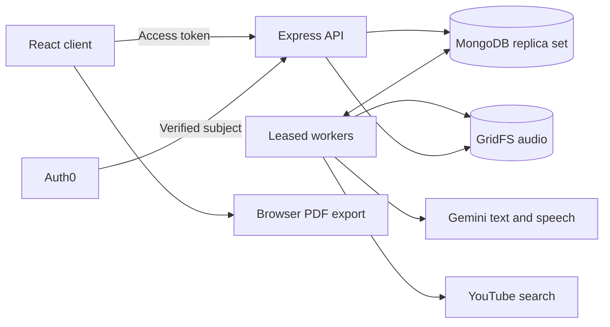

# Text to Learn

[](https://github.com/SwarnavaItIs/AI-Course-Generator/actions/workflows/ci.yml)

Turn a topic into a course, then work through it one lesson at a time. Text to Learn uses Gemini to build an ordered curriculum and generate lessons as you open them. Courses, lesson content and progress are saved to your account.


## Features

- Courses with 3–6 modules and 3–5 lessons per module, including objectives and suggested readings.
- Lessons with formatted explanations, highlighted code, and 4–5 practice questions with answer explanations.
- Existing YouTube videos, Hinglish explanations, and downloadable speech audio.
- Full lesson PDF exports with code, links and quiz answers.
- Saved progress, previous/next navigation, cached lessons and controlled retries when generation fails.
- Auth0 sign-in and a private course library. A public sample is available without an account.

The frontend uses React, TypeScript, Vite and Tailwind. The API uses Express and MongoDB, with shared Zod schemas for validation. Audio is stored in MongoDB GridFS.

## Run locally

Requires **Node 24**, npm, and a MongoDB replica set for the full application. Atlas works, or use the included Docker Compose setup.

```sh
npm ci
cp client/.env.example client/.env
cp server/.env.example server/.env
```

On PowerShell, use `Copy-Item` instead of `cp`. Fill in the environment files, then run:

```sh
docker compose up -d --wait # skip when using Atlas
npm run dev
```

Open `http://127.0.0.1:5173`. The API runs on port 3001. Use `docker compose stop` to stop the local database while keeping its data.

To try just the public sample without configuring a backend:

```sh
npm run build -w @text-to-learn/contracts
npm run dev -w @text-to-learn/client
```

### Configuration

| Location | Variables                                                          | Purpose                                         |
| -------- | ------------------------------------------------------------------ | ----------------------------------------------- |
| Server   | `MONGODB_URI`                                                      | Atlas or another MongoDB replica set            |
| Server   | `AUTH0_DOMAIN`, `AUTH0_AUDIENCE`                                   | Token issuer and API identifier                 |
| Server   | `CLIENT_ORIGINS`                                                   | Allowed frontend origins                        |
| Server   | `GEMINI_API_KEY`, `GEMINI_TEXT_MODEL`                              | Course, lesson and Hinglish generation          |
| Server   | `GEMINI_TTS_MODEL`, `GEMINI_TTS_VOICE`                             | Speech generation; default voice is Kore        |
| Server   | `YOUTUBE_API_KEY`                                                  | YouTube Data API v3 search                      |
| Client   | `VITE_AUTH0_DOMAIN`, `VITE_AUTH0_CLIENT_ID`, `VITE_AUTH0_AUDIENCE` | Public Auth0 SPA settings                       |
| Client   | `VITE_API_URL`                                                     | Backend origin; leave blank for the local proxy |

Create an Auth0 Single Page Application and an API using RS256. Set the same domain and audience on both sides. Add `http://127.0.0.1:5173` and `http://localhost:5173` to the SPA's allowed callback URLs, logout URLs and web origins. The callback uses the site root.

Keep private credentials in `server/.env` or backend hosting settings. Variables prefixed with `VITE_` are included in the public frontend build. Provider settings are optional at startup; the corresponding tools show an unavailable state until configured.

## How generation works

Topic submission saves a pending course and a job in MongoDB. A worker requests structured output from Gemini, validates the result, and saves the complete outline. Opening a lesson queues its content separately. Reopening a ready lesson reads the saved content without another generation request.

Jobs have attempt limits and expiring leases so they can recover after a restart. Concurrent requests share existing work, and only the current worker can publish a result. Video, transcript and audio jobs run independently, so a failed tool leaves the lesson usable.



### Data model

| Record             | Stores                                                                        |
| ------------------ | ----------------------------------------------------------------------------- |
| User, Course       | Auth0 subject, owned library, topic and generation state                      |
| Module, Lesson     | Ordered curriculum, objectives, resources, validated blocks and quizzes       |
| Progress           | One completion set per user and course                                        |
| GenerationJob      | Unique target, attempt count, retry time and expiring worker lease            |
| Enhancement        | Cached videos, transcript or audio variant keyed by source and model settings |
| AudioAsset, GridFS | Owned audio metadata, durable bytes and cleanup state                         |

Course creation, publication and deletion use transactions. Every private child operation checks the parent course's owner; another user's records return 404.

### API overview

Private routes require a Bearer access token. Bodies and responses use the shared schemas.

| Method and route                                                                      | Purpose                                                 |
| ------------------------------------------------------------------------------------- | ------------------------------------------------------- |
| `GET /health`, `GET /ready`                                                           | Liveness and database readiness                         |
| `GET /api/sample`                                                                     | Public sample course                                    |
| `GET /api/courses`, `POST /api/courses`                                               | Read the owned library; save a sample or submit a topic |
| `GET /api/courses/:courseId`, `DELETE /api/courses/:courseId`                         | Read or delete an owned course                          |
| `POST /api/courses/:courseId/retry`                                                   | Retry a failed outline within the attempt limit         |
| `GET …/lessons/:lessonId`, `POST …/lessons/:lessonId/generate`                        | Read saved lesson content or request generation         |
| `GET …/lessons/:lessonId/enhancements`, `POST …/lessons/:lessonId/enhancements/:kind` | Read or request videos, transcript and audio            |
| `GET …/lessons/:lessonId/audio/:assetId`                                              | Read owned WAV bytes                                    |
| `POST …/lessons/:lessonId/completion`                                                 | Set completion without double-counting                  |

The abbreviated routes continue from `/api/courses/:courseId`. See the [API reference](docs/api.md) for request examples, states and errors.

## Project layout

```text
client/              React app, lesson view and PDF export
server/              Express API, providers, workers and audio storage
packages/contracts/  Shared schemas, types and public sample
tests/               Integration tests, browser tests and evaluation scripts
docs/                Architecture, API, deployment and testing guides
```

## Checks

```sh
npm run format:check
npm run lint
npm run typecheck
npm run build
npm test
npx playwright install chromium
npm run test:e2e
npm run inspect:production
```

Tests use isolated MongoDB, signed test tokens and provider fixtures. They cover ownership, persistence, generation failures, duplicate requests, caching, audio, PDF export and progress. CI runs the same checks on Linux. See [testing](docs/testing.md) for provider evaluations, test artifacts and coverage limits.

## Documentation

- [Architecture and data model](docs/architecture.md)
- [API reference](docs/api.md)
- [Deploy on Vercel and Render](docs/deployment.md)
- [Testing and evaluation](docs/testing.md)
- [Demo script, shot list and résumé bullets](docs/demo.md)
- [Screenshots](docs/screenshots/README.md)

## Limitations

Generated content can be wrong even when it passes schema validation. The reading catalogue is small; additional suggestions are labelled as unverified. PDFs contain rasterized text, so text selection and search are unavailable. Workers pause when the backend host sleeps, and recovery can repeat an upstream provider request.

Public deployment, real Auth0 login, live provider output and Hindi-English pronunciation still need verification with configured accounts. The screenshots include local test fixtures; they do not represent a live deployment.
