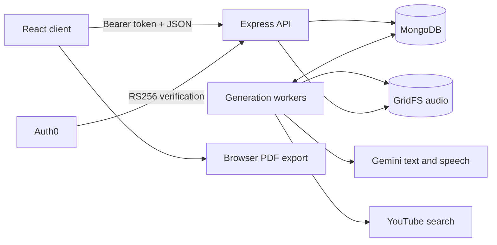

# Architecture

The repository uses npm workspaces: a React client, an Express API, and a shared package of Zod schemas and TypeScript types. Build the contracts package before starting either application.

## Authentication and ownership

Public routes serve the bundled sample. Private routes verify the access token's signature, issuer, audience and expiry. Ownership comes from the verified Auth0 subject, never a request body. The API checks the parent course before accessing a lesson, enhancement or audio asset. Another user's records return 404.

The Auth0 SDK keeps tokens in memory. Callback state accepts internal paths only. The client validates API responses with the shared schemas; personal responses use `Cache-Control: no-store`.

## Data model

| Record        | Purpose and key constraints                                        |
| ------------- | ------------------------------------------------------------------ |
| User          | Auth0 subject and saved-course counter                             |
| Course        | Owner, topic, generation state; unique owner/request ID            |
| Module        | Course and ordered position; unique course/position                |
| Lesson        | Module, metadata, content and content hash; unique module/position |
| Progress      | Unique owner/course pair with a set of completed lesson IDs        |
| GenerationJob | Unique target, attempts, retry time, lease and worker token        |
| Enhancement   | Videos, transcript or audio; unique source/model/version cache key |
| AudioAsset    | Owned GridFS reference, format metadata and cleanup state          |

Domain IDs are UUIDs. Positions determine display order. Course creation, publication and deletion use MongoDB transactions, so a replica set or sharded cluster is required. Indexes are initialized before requests are served.

## Course and lesson generation

Submitting a topic creates the course, progress record and job in one transaction. The request ID makes repeated submissions idempotent. Opening a lesson queues a unique lesson job; ready lessons keep their saved content even when model settings change.

Workers scan once per second. Claiming a job increments its attempt count and assigns a lease token. Text jobs have a 45-second deadline and a 60-second lease. Failed retryable jobs get two automatic attempts, with explicit retries allowed up to four total. Expired leases recover after restart.

The Gemini adapter requests structured JSON through the Interactions API. Prompts treat topic and lesson context as untrusted input. Provider responses cannot assign owners, IDs or states. Resource IDs resolve through a fixed catalogue; other suggestions have no clickable generated URL.

Before publication, the worker validates all content and checks that its lease and parent record still exist. Publication is transactional, preventing partial ready content and writes from expired workers. Recovery may repeat an upstream request; the database guarantees one accepted publication, not exactly-once provider execution.

## Lesson tools

Video search uses fixed YouTube endpoints and up to three lesson queries. Results must be public, processed and embeddable; live, age-restricted and region-restricted videos are excluded. Results expire at the next UTC day. An empty result is a valid cached response.

Hinglish generation preserves the lesson context and technical terms. Audio uses the saved transcript and an explicitly configured speech model and voice. The adapter checks actual MIME type, WAV structure, PCM format, size and duration. Declared raw PCM is wrapped only when its sample rate is known.

Enhancement cache keys include the owned lesson, source hash, prompt version, model, language and relevant voice/transcript hash. Changed settings create a new variant. Enhancement jobs use a 70-second deadline and 90-second lease, sharing the per-user job quota with course generation. Their failures do not change lesson content.

Audio is stored in `lessonAudio.files` and `lessonAudio.chunks` through a storage adapter. Uploads are registered before writing, then published after lease validation. Deletion marks assets for cleanup; subsequent worker scans remove files and abandoned chunks. Cleanup records survive restarts and include a five-minute window for late uploads.

Audio reads require ownership and a matching ready enhancement. They support a single byte range. The browser fetches authenticated bytes, creates a temporary object URL, and revokes it after use. Playback never starts automatically.

## Rendering, export and progress

React renders lesson text directly. Syntax highlighting produces text spans rather than executing code or inserting provider HTML. Quizzes are local practice with explanations.

PDF export builds a dedicated A4 layout from the full lesson. It keeps ordinary blocks together, splits oversized paragraphs and code before capture, and records source offsets to check coverage. Each page is captured separately with html2canvas and added to jsPDF with link annotations. Text is rasterized; exports are capped at 120 pages.

Completion uses MongoDB set operations, so repeated updates do not double-count. Library and course views read the same progress record.

## Runtime limits and recovery

| Limit                  | Value                                    |
| ---------------------- | ---------------------------------------- |
| API requests           | 120 per minute per IP, per process       |
| JSON request body      | 16 KiB                                   |
| Saved courses          | 100 per user                             |
| Active generation jobs | 3 per user across all kinds              |
| Attempts               | 2 automatic, 4 total with manual retries |
| Audio                  | 12 MB and 240 seconds                    |
| PDF                    | 120 pages                                |

Startup validates configuration, database transaction support and indexes, then binds HTTP before starting workers. `/health` reports liveness; `/ready` checks MongoDB. Shutdown stops HTTP and workers together, disconnects MongoDB and has a ten-second deadline.

CORS accepts exact origins. Production trusts one proxy hop for Render ingress. Multiple API replicas need a shared rate-limit store. A sleeping host pauses workers; queued jobs and cleanup state remain in MongoDB.

See [testing](testing.md) for the fixture boundary and [deployment](deployment.md) for production settings.
